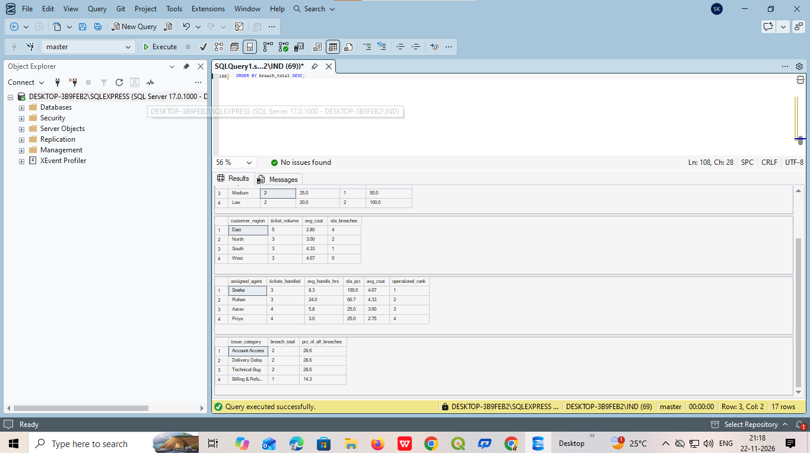
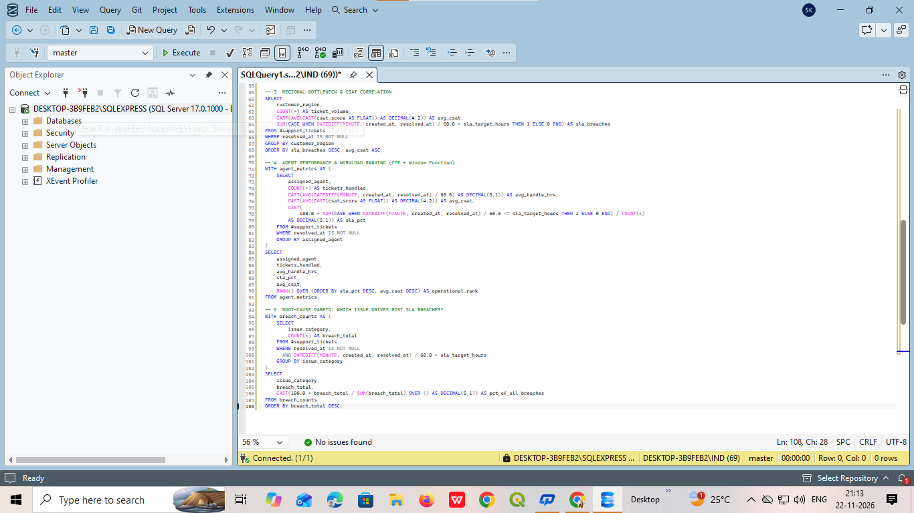

# 📊 Customer Operations & SLA Performance Analysis (T-SQL)

### 📌 Business Context
High-volume customer support operations often mask critical SLA bottlenecks behind healthy overall averages. Using **SQL Server (T-SQL)**, this project audits operational ticket logs across priority tiers, regions, and support agents to isolate root causes behind SLA breaches and customer satisfaction (CSAT) drops.

---

### 🛠️ SQL Techniques Demonstrated
- **Data QA & Hygiene:** Auditing open backlog tickets (`NULL` handling) and missing CSAT survey responses prior to KPI aggregation.
- **Conditional Aggregations (`CASE WHEN`):** Measuring SLA compliance rates against dynamic priority targets (2h, 4h, 24h, 48h).
- **Common Table Expressions (CTEs):** Structuring modular agent-level and category-level aggregations for clean, production-grade SQL.
- **Window Functions (`RANK()`, `SUM() OVER()`):** Ranking agent performance across dual KPIs (SLA % + CSAT) and computing Pareto breach shares.

---

### 🔍 Key Operational Findings & Recommendations
1. **Critical Priority Bottleneck (25.0% Compliance):** Only **1 out of 4 `Critical` tickets** met the 2-hour SLA target (`3.0 hrs` average resolution), compared to **100.0% compliance** on `Low` priority tickets.
   - *Recommendation:* Introduce dedicated fast-track triage for `Critical` escalations during peak hours.
2. **Regional SLA & CSAT Disparity:** The **East region** recorded the highest SLA breaches (**4 breaches out of 5 tickets**) and the lowest average CSAT (**2.80 / 5.00**), whereas the **West region** achieved **0 breaches** and **4.67 CSAT**.
   - *Recommendation:* Rebalance regional ticket routing and audit escalation handoffs in the East queue.
3. **Agent Workload vs. SLA Trade-off:** **Sneha** ranked **#1** (`100.0%` SLA compliance, `4.67` CSAT across 3 tickets), while **Aarav** and **Priya** handled higher ticket volumes (`4` tickets each) with lower SLA compliance (`25.0%`) due to `High`/`Critical` queue concentration.
   - *Recommendation:* Redistribute `Critical` and `High` priority tickets more evenly across the team.
4. **Root-Cause Distribution:** **Account Access**, **Delivery Delay**, and **Technical Bug** each accounted for **28.6%** of total SLA breaches (together driving **85.8%** of all missed SLAs).
   - *Recommendation:* Prioritize automated password-reset self-service and proactive delivery tracking alerts.

---

### 📸 Query Output Previews

**1. Data Quality, Priority SLA, Regional & Agent Ranking Outputs**

**2. Agent Ranking & Root-Cause Pareto Outputs**

